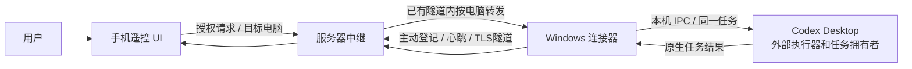
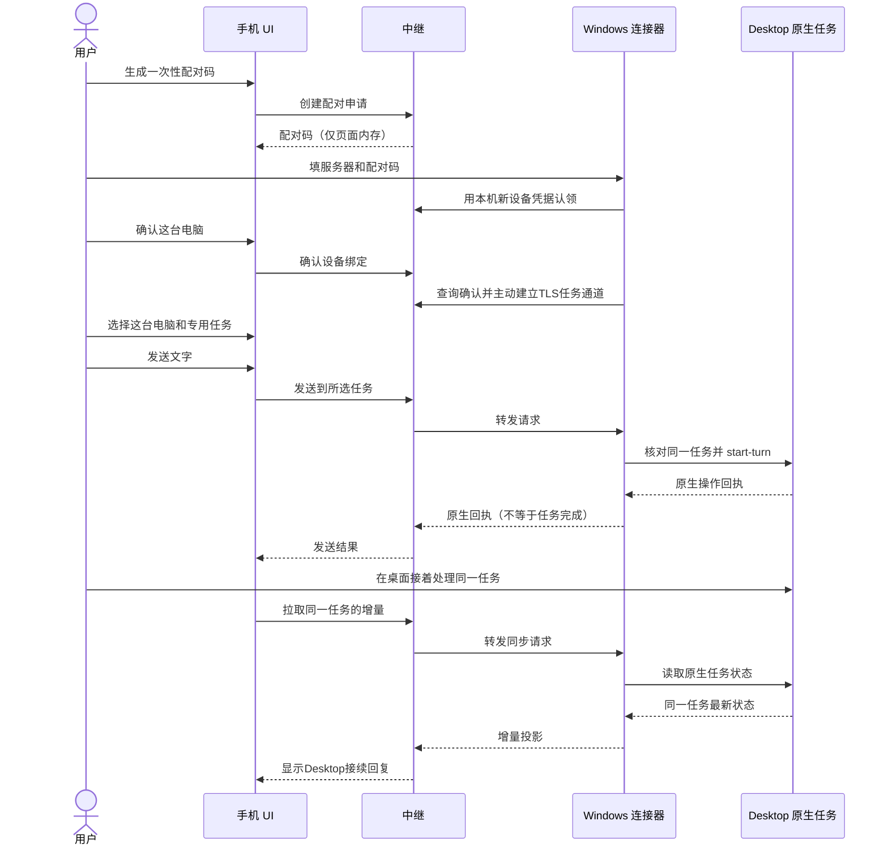

## 2026-10-16 Windows 更新恢复边界

安装前继续独占应用/运行锁并核验原生空闲；隔离健康改为原生权限/回执/任务可核验性、通道正常退出和保全摘要，允许准入后 Desktop 开始工作。未激活候选失败时，经清理/保全/旧指针复验后进入 rollback_restoring，受信独立恢复入口装载旧 GUI，等父助手明确激活并落盘 rolled_back 才重连。激活可能已发生或未知回执不自动回退。

## 已有对话的明确接入

Windows alpha.23 的本机 linkedConversations 逐条绑定已有 ID、真实目录、originator 与 threadSource；来源仍限定本机 vscode，guardian/subagent 不能接入。没有手机扩权接口，不写 Desktop 数据或伪造创建回执。目录只为匹配的接入项标注 linkedEmptyHistory，业务层仍逐次取得完整原生快照与权限核验。配置和接入标题不随包分发。

## Android alpha.21 / Windows alpha.22 创建空对话（构建验证中）

2026-10-16用户明确允许仅创建空对话的 app-server 例外。手机提交当前电脑的项目标识、标题与稳定 createRequestId，沿现有 `/api/projects/{id}/sessions` 路由及原鉴权转发，不新增中继路由或端口。项目标识由已核验的本机目录去重产生，不接受手机传目录。

本机先持久化创建账本，再用精确兼容版本的 Codex stdio app-server 初始化、thread/start、thread/name/set、thread/read。命名是空对话落盘所必需；只拿到 start 返回的 ID 不算成功。辅助进程正常退出后，原核验深链让 Desktop 打开同一 ID；follower 核对目录、权限和原生状态后才确认创建。辅助进程不发送模型输入、不复制线程、不修改 Desktop 内部文件、不监听网络端口，不借用当前执行回合或工具管道。

创建回执与发送/问答共用原账本，pending 创建继续阻止发送、断开确认与 OTA，旧版本保护同样识别 pending。保存了真实 ID 但接管失败时，同编号只继续 Desktop 接管，不能再创建。仅持有本机创建回执的空对话可以显示已确认空闲的空历史；其他 history_empty 规则保持。手机加密保存账号/电脑作用域的原请求与可选消息草稿，成功后持久写入原草稿库，由用户手动发送，继续使用既有发送编号和回执。

实验证据、构建与未验收层级见 [新建对话](MOBILE-CREATE-CONVERSATION.md)。本次不替换现有连接，不把本机创建/接管或合成测试算真实手机点击成功。

## alpha.20 / Windows alpha.19 额度与阅读信号

mobileSignals与mobile-sync共用readRevision/readKey，只返回修订及定位键，不在通知信号中携带正文。Desktop原生明确running优先于目录摘要；旧连接器无信号时未知。额度账号ID在本地受限读取后做域分离SHA256，线上只有哈希，不带邮箱、账号原文或令牌；登录文件晚于额度采样时不关联。手机前台轮转只读signals，最多3并发，不传open=1。每账号一个LiveQuotaScene，切设备不重建；断线/过期不推断完成。阅读水位本机加密按服务/账号/设备/线程隔离。

## alpha.19 本地预览解码

WebViewClient.shouldInterceptRequest也收到loadDataWithBaseURL生成的data请求。统一403会误拦主文档；现在仅data方案返回null走本地解码，所有其他资源仍返回403，网络/文件/内容/导航与CSP限制不变。onPageCommitVisible之后才记已显示，主框架渲染错误单独报告并用原生层覆盖；相同绑定仅在渲染失败后刷新重建。

## alpha.18 预览内容与安装包分离

PreviewFeedClient用现有登录原生GET同源/desktop-remote-previews/test/latest.json，客户端只发送到与安装trust相同的origin，不跟随重定向。独立用途签名封套renderer=1、sequence、有效期、HTML哈希，RSA原公钥核验及本机防回退；缓存按origin+登录哈希隔离，以AtomicFile保存，失败仅显示有效上次预览。WebView只收到已核验的HTML，无token、JS/native桥、文件/内容访问、网络、外跳或下载，CSP再限制connect/frame/worker/form/base。

既有:9443 Caddy只增加一个GET JSON路由，forward_auth复用账号只读/control-api/version，不重启relay、不新增端口；静态根仅/config/ui-preview-test/latest.json，原APK鉴权路由不变。只首次验证并热加载配置，以后预览发布只原子替换独立JSON，APP/Windows/relay版本及服务进程不必变。手机安装与真实缓存/WebView体验仍须验收。

## alpha.17 账号额度动效演示隔离

QuotaActivityPreview持有合成A/Plus和B/Pro设备、任务开关及独立动画模型，不读取Gateway、账号令牌或真实任务。QuotaActivityMotion用指数渐入/渐出积分转角，账号A两设备共用一个模型、账号B独立；减少动画与后台无循环。drawQuotaCore仅增加可选activity参数，默认null；TerminalGrid默认showQuota=true，正式调用点不变。真实联动尚需授权数据源提供可信账号标识和新鲜运行信号，不能用套餐名推断账号或以连接在线推断任务运行。

## alpha.16 原生预览隔离

预览为我的页内独立全屏Dialog，不持有Gateway、TaskTarget、DraftStore或正式回执存储。演示设备各自的完成版本/阅读水位只写interface-preview-only-v1；输入及模拟发送只在预览内存。前台可见才记读，后台停止动效。正式网络、连接、身份、草稿和发送/答案回执路径不改。

## Android alpha.12 项目资料归属

任务仓库的ProjectRepositoryStore按中继与账号作用域使用Android加密存储，与执行电脑和Desktop线程分别保存。schemaVersion=1导入要求显式核对，repository.fullName仅为关联标识，不授予GitHub访问权限。任务清单、进度和验收由用户管理；导出是用户选择的本机文档，不自动提交到仓库。

多电脑对话复用TaskTarget、Gateway与原发送/答题回执。状态筛选仅使用同目标的原只读signals和已打开快照；分批核对，过期/未知排除。问题生命周期按request id、revision隔离，旧题消失只使其不可提交；未知提交不能因此被确认为成功。

# 原型关系与数据归属

三个原型串接已有 Desktop 原生任务；身份、路由和任务数据各有权威来源。当前实测范围与待验收项见根目录 [STATUS.md](../STATUS.md)。

三端 OTA 已列为新增必做范围：发布签名与更新分发独立于任务转发，三个软件分别安装自己的版本；发布关系图、数据保留和失败恢复要求见 [OTA.md](OTA.md)。下图描述现有任务链路，不代表 OTA 已上线。

- **身份与授权：**服务器中继校验账户、设备和目标电脑路由；Windows 连接器保存本机 CurrentUser DPAPI 保护的配对身份及明确的任务绑定。手机只使用获授权的目标，不因能连通就获得其他电脑或任务权限。
- **任务数据：**Desktop 持有原生任务、执行与权限状态；连接器只维护必要的同步游标、操作回执和本机运行状态；中继转发请求，不成为原生对话数据库。手机展示同步投影与本地草稿。
- **故障边界：**发送回执、网络连通和 `connected` 不能证明任务完成。未知发送结果保留为未知并阻断重复提交；断线重连须通过连接器的状态核对。旧 Gateway 迁移另有前置条件，不属于这条原型链路。

多电脑路由使用目标电脑标识隔离请求，但当前只验收一台电脑的一条任务；不得据此声称所有电脑、Android 新包或新提取中继已通过。原公网服务和用户现装 APK 不在本原型变更范围。

alpha.11 候选保持同一电脑连接，只在本机加入显式 `additionalTasks` 清单。每项有独立 Follower/Service/权限摘要；HTTP按任务ID路由，原手机任务列表与中继API复用。TaskService统一写操作/断开/OTA检查，Receipts和MobileSync均以任务ID区分数据。当前仅用户指定的原测试任务与开发对话被准备接入，安装和手机验收状态见STATUS。

## alpha.12 自动目录与按需接续

`desktop_catalog.py` 以 SQLite 正常只读WAL视图读取标题/ID/目录，`catalog.js` 交给 `TaskService`；列表请求不创建 Follower。点开时按 ID 找本机目录，再经原 Follower 获取 Desktop 快照；Service 继承原任务权限，手机不提供目录、权限或执行端参数。`activity.js` 只记录实际手机交互任务的交接范围，用于跨进程更新检查；它不是另一份对话数据库。

### alpha.13 GitHub项目和设备额度

GitHubProjects仅在Android向api.github.com发起只读REST；使用本机加密凭据、固定默认分支commit、有限文档解析和最后成功缓存。任务仓库不经中继转发GitHub token。DeviceQuotaStore使用现有mobile-sync授权读，在账号内按deviceId隔离来源；既有身份/发送/问答回执路径不变。详见PROJECT-REPOSITORY.md和QUOTA-CORE-GLOW.md。
