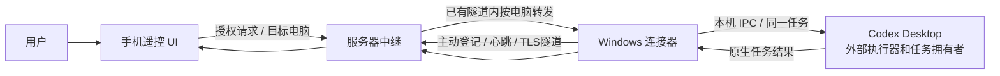
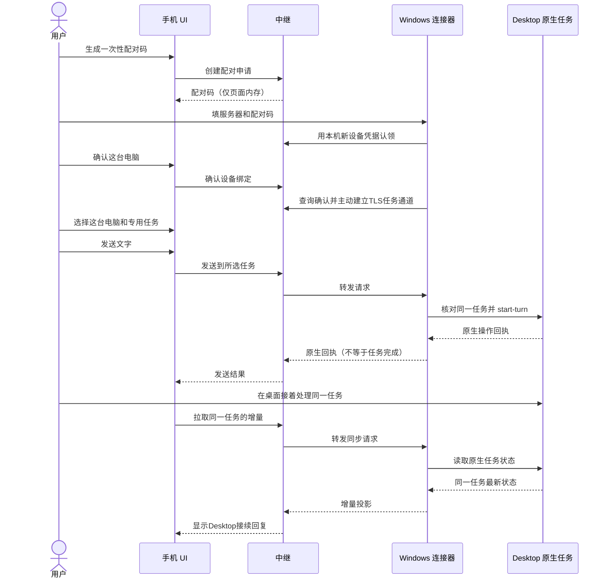

# 原型关系与数据归属

三个原型串接已有 Desktop 原生任务；身份、路由和任务数据各有权威来源。当前实测范围与待验收项见根目录 [STATUS.md](../STATUS.md)。

- **身份与授权：**服务器中继校验账户、设备和目标电脑路由；Windows 连接器保存本机 CurrentUser DPAPI 保护的配对身份及明确的任务绑定。手机只使用获授权的目标，不因能连通就获得其他电脑或任务权限。
- **任务数据：**Desktop 持有原生任务、执行与权限状态；连接器只维护必要的同步游标、操作回执和本机运行状态；中继转发请求，不成为原生对话数据库。手机展示同步投影与本地草稿。
- **故障边界：**发送回执、网络连通和 `connected` 不能证明任务完成。未知发送结果保留为未知并阻断重复提交；断线重连须通过连接器的状态核对。旧 Gateway 迁移另有前置条件，不属于这条原型链路。

多电脑路由使用目标电脑标识隔离请求，但当前只验收一台电脑的一条任务；不得据此声称所有电脑、Android 新包或新提取中继已通过。原公网服务和用户现装 APK 不在本原型变更范围。
