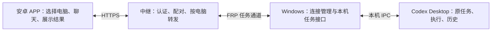

# 代码导览

核对日期：2026-10-12。本文整理现有代码，不移动目录、不合并分支、不改变运行安装。

## 从哪个目录开始

GitHub 仓库为 https://github.com/nzkres/codex-desktop-remote 。本机 work 下四个目录是同一个 Git 仓库的独立工作树，并非四个产品：

| 目录 | 分支 | 用途 |
| --- | --- | --- |
| codex-desktop-remote-desktop1007 | codex/desktop-1007-recovery | 当前阅读入口；Windows alpha.8 修复及安卓恢复验收记录 |
| codex-desktop-remote-android-alpha6 | codex/android-alpha6 | Android OTA 后续开发，未因 Windows 修复自动合并 |
| codex-desktop-remote-alpha7 | codex/windows-alpha7 | 前一轮 Windows alpha.7 OTA 工作 |
| codex-desktop-remote | codex/controlled-alpha5 | 较早基线工作树 |

不能假定 GitHub main 或任意一个工作树包含其他分支的全部最新改动。实际进度先看 STATUS.md，再看对应分支。不要为了整理直接删除或覆盖这些目录。

## 三端关系

Windows 主动建立通道到服务器，手机通过服务器访问它。任务实际由 Desktop 执行；手机和电脑继续的是同一个原生任务。中继不运行模型，连接器不复制一份任务。

## 核心文件与阅读顺序

| 顺序 | 文件 | 解决的问题 |
| --- | --- | --- |
| 1 | windows/gui.py | 窗口按钮和状态显示，用户怎样配对、连接、断开 |
| 2 | windows/controller.py | 把 GUI 操作接到连接核心，管理本机适配进程和隧道 |
| 3 | windows/vendor/connector_core.py | 配对、心跳、身份保存和连接循环 |
| 4 | src/main.js | 启动本机 Node 接口，校验配置、兼容版本及独占实例 |
| 5 | src/service.js | 手机读历史、发消息、停止以及断开/更新预检的接口与权限判断 |
| 6 | src/follower.js | 跟随指定 Desktop 任务，读取新鲜状态、转发原生操作 |
| 7 | src/vendor/desktop-ipc.js | 底层 Desktop 通信；初读可以跳过 |
| 8 | src/vendor/desktop-state.js、mobile-sync.js | 把原生状态整理为手机可增量显示的内容 |

src/ 是 Windows 连接器的一部分，不是独立的第四个服务。Python 管窗口、身份和进程；Node 管 Desktop 通信与手机任务接口。src/receipts.js 保存发送回执，防止结果不明时重复发送；src/compatibility.js 检查支持的 Desktop 文件版本。

## 手机和中继从哪里读

Android Kotlin 源码根为 android-native/app/src/main/java/dev/codex/remote/：

- MainActivity.kt：应用入口。
- TerminalScreen.kt、TerminalControl.kt：电脑列表和配对交互。
- ChatScreen.kt：聊天界面；Gateway.kt：网络请求与数据解析；TaskTarget.kt：当前目标电脑。
- DraftStore.kt：草稿；Transcript*、Glass* 等文件：复用的消息展示及视觉组件，初读不必逐个展开。
- UpdateClient.kt、UpdateSecurity.kt、UpdateGate.kt：检查、验证和控制 Android 更新。

中继 relay/：control_server.py 是 HTTP 入口，registry.py 管设备/配对记录，forwarder.py 按目标转发，gateway_link.py 管通道关联，auth/auth_server.py 提供账户认证相关服务。中继负责授权和路由，不保存 Desktop 原生对话作为权威记录。

## 连接、断开和重连

1. 首次手机生成配对码，电脑认领，手机确认；后续复用本机身份。
2. 点击连接，controller 等待登记确认，启动本机任务接口及 FRP 通道，再持续心跳和健康检查。
3. 手机请求经中继到 src/service.js；先核对原任务和权限，再读状态或交给 Desktop 执行。
4. 正常断开先停止接受新的操作并检查未完成状态，再清理自己启动的进程树；不会按名称杀掉 Desktop。
5. 重连复用身份，但仍检查 Desktop 版本、任务和权限。网络重试不等于任何故障都能自动恢复：异常退出的现场或权限变化目前仍可能阻断。这是现有局限，不能把 alpha.8 本次修复称为通用自动重连。

## OTA 是另一条流程

任务通道与软件更新分开理解。windows/update_ui.py 提供入口，update_helper.py 和 update_driver.py 负责独立助手及 Windows 安装；updates/security.py、engine.py、storage.py 等承载验签、升级事务和持久记录；relay/update_driver.py 负责中继更新适配。先读 docs/OTA.md，再按组件跟踪，不必一开始读所有恢复代码。

版本说明：windows/releases.json、android-native/releases.json、relay/releases.json；生成的阅读文档在 docs/versions/。安装从 docs/install/README.md 开始。

## 源码、安装和临时维护资料的区别

- 当前开发源码：本工作树；修改源码不会自动改变正在运行的安装。
- 当前 Windows 安装：本机 Codex AppX LocalCache/Local/CodexDesktopRemoteTest9443；versions/ 放版本，data/ 放本机配置与受保护身份。不要编辑版本文件或把 data 提交 Git。
- artifacts/：被忽略的构建包、脱敏验收和本机一次性维护资料，不是公共产品源码。desktop1007 下本次修复脚本绑定特定安装，不应直接复制给其他电脑运行。
- test/、relay/test_*.py、Android src/test/：各层自动测试；自动测试通过不代替手机实际验收。

推荐先读本文 → docs/ARCHITECTURE.md → windows/controller.py → src/service.js → src/follower.js。理解一次消息如何往返以后，再看 UI 细节和 OTA。最新实机结果始终以 STATUS.md 为准。
