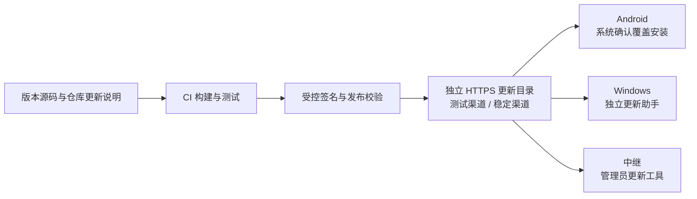

# 三端 OTA 更新要求与验收

用户于 2026-10-07 明确要求：**Android、Windows 连接器、服务器中继都必须通过 OTA 迭代版本。** 这是正式产品范围，取代之前“简化原型不包含 OTA”的排除项。

本文是新增要求和实现约束，**不是已实现声明**。仓库记录的三个组件版本均为 `0.1.0-alpha.2`，均没有本项目可用的 OTA 闭环；不能把版本说明页面、APK 下载链接或本地版本命令说成 OTA。实现、构建、发布、安装与实机结果分别进入 [STATUS](../STATUS.md)。已发布版本的历史说明保持原样。

## 用户应怎样更新

首次安装用于建立可信更新入口；之后不再要求用户下载源码、执行 Git/npm 或手动上传每版程序。第一版由用户触发安装，自动检查可以在后台进行，不能静默切换现用版本。

| 软件 | 必须提供的更新入口 | 更新过程 | 完成依据 |
| --- | --- | --- | --- |
| Android App | “我的 → 版本与更新说明 → 检查更新” | 展示当前/候选版本、渠道、更新说明与兼容性；用户选择下载，验证后唤起系统安装确认 | 同包名、同可信签名覆盖安装；重新打开后核对实际安装版本，登录与本地草稿保留 |
| Windows 连接器 | 原连接窗口内“检查更新 / 安装更新” | 展示说明与进度；活跃任务、审批或未知操作时延期；独立助手在窗口退出后完成版本切换 | 新进程实际启动、身份/任务绑定/权限与回执保留、所需兼容与通道健康验证通过；否则回退或停在可诊断状态 |
| 服务器中继 | 服务器管理员的独立更新工具，提供检查、安装、状态、恢复入口 | 在线拉取签名包；维护窗口内验证请求已排空、相关任务可安全更新，再切换服务版本 | 新服务实际监听、认证/登记数据保留、版本与转发健康验证通过；失败恢复旧程序或保留维护状态 |

中继第一版可以使用管理员命令行完成在线更新，不额外建设管理网站。普通手机登录凭据不能触发服务器执行或安装任意程序。三端可以独立升级，但候选包必须声明协议与依赖兼容范围；顺序有要求时在更新说明中明确显示。

“下载完成”“已交给系统安装”“新程序已启动但通道未验证”是独立状态，不能显示为“更新成功”。更新器不更新 Codex Desktop/CLI，不修改其内部文件，不为安装新版放宽权限或兼容门槛。

## 最小发布结构

建议在现有服务器使用独立的 HTTPS 更新目录，例如 `/desktop-remote-updates/`；这是待配置的逻辑路径，不是当前可用地址。测试与稳定渠道分开，三个组件的元数据与构件分别保存，保留旧版。更新静态文件与正在替换的中继进程分开服务，使中继停止时仍能取得更新和恢复信息。

仓库主线保存三个组件的更新说明；各端从已验证元数据展示对应说明，不再手写另一份。GitHub Release 可保存归档构件，但私有下载不能靠把 GitHub PAT 放进客户端解决；14 天 Actions artifact 也不能承担长期 OTA。新的更新目录与产品标识不得覆盖旧 Android `/api/android/update` 或 `relay-updates` 服务。

更新信任必须由首次安装固定的发布公钥/可信配置建立，不能在同一次未经验证的下载中接受新公钥。元数据至少绑定产品、组件、平台/架构、渠道、版本、发布序号、有效期、包大小、哈希、兼容范围、更新说明和数据格式。签名覆盖这些字段；下载限制大小、校验 TLS、拒绝不可信跳转与路径，完整校验后才准许安装。

防止旧版本重放、相同序号换内容和同版本换包；合法回退只允许事务中已验证的上一版本，不能用普通更新入口任意降级。签名私钥、服务器凭据和 PAT 不进入 Git、APK、Windows 包或日志；测试使用合成密钥，正式发布使用受控的长期密钥。

## 三端各自需要补齐什么

### Android：先建立可连续升级的安装基线

- 固定本项目包名 `dev.codex.desktopremote.lite`，维护递增 `versionCode`，用同一受控 Android 签名证书发布连续版本；元数据另由可信发布者签名。
- 更新前检查目标包名、版本、系统版本、安装签名与文件完整性；下载到应用私有暂存目录，经 FileProvider 交给系统。面向 API 26+ 声明 `REQUEST_INSTALL_PACKAGES` 并检查 `canRequestPackageInstalls()`，安装权限与最终确认由用户完成。
- 更新检查、下载失败或用户取消不清理登录/草稿，不自动重发消息；存在未确认发送时延期进入安装。
- 当前 alpha.2 是环境生成的 debug 签名，不能承诺它可直接覆盖升级到后续正式签名包。建立 OTA 基线前核对实际已装证书与是否掌握对应签名密钥；无法兼容时另行说明首次安装/数据保留办法，不默认要求卸载。
- Android 普通应用不能承诺静默降级旧 APK。安装失败保留原应用；若新版本已装但有缺陷，发布同签名、更高 versionCode 的修复包，且其数据格式必须兼容；不得强制卸载或用旧备份覆盖新数据。

平台依据：[Android 应用签名与升级](https://developer.android.com/studio/publish/app-signing)、[请求安装应用的权限检查](https://developer.android.com/reference/android/content/pm/PackageManager#canRequestPackageInstalls())。这些平台机制不能替代本项目的更新元数据验证和真机安装验收。

### Windows：版本目录、数据目录、更新助手分离

- 建立安装后的固定启动入口；下载到新暂存目录，将已验证版本存入独立版本目录，原版本保留。Python/Node/FRP 与适配器文件应有清楚的随包方式、版本清单和指纹；涉及运行包变化时与客户端切换分别检查。
- 本机 DPAPI 身份、配置、任务绑定、权限摘要与回执使用稳定数据目录。首次布局迁移必须明确核验，不能复制其他电脑或旧项目的真实身份冒充安装。
- 独立助手不随客户端窗口退出而终止；使用独占锁、完整旧状态比较与事务日志进行切换，不能原地覆盖运行中文件。
- 先核对活跃回合、审批和未知操作，再建立阻止新操作的边界；只凭“已断开”、`connected` 或 `probe_verified` 不足以证明可更新。
- 只管理自己持有原始句柄的进程及已确认归属的进程树。失败候选及其全部后代退出后才可回退；检查与终止之间自然退出的竞态也必须通过同一原始句柄判断，不按旧 PID 重新打开。
- 新窗口启动但尚未核验任务通道时保持“待验证”；不能为尽快显示成功清除 `runtimeNeedsReview`、重放发送或强制退出 Desktop。

### 中继：独立更新工具与可证明的维护窗口

- 更新工具独立于被替换的服务；稳定配置、账号库和设备登记库与版本目录分离，服务重启不改变账户或设备绑定。
- 更新前同时处理认证、控制 API、设备心跳/配对、FRP plugin 与任务转发的准入。保留已准入请求，未完成写请求、配对待确认、活跃任务或结果未知时延期；不能关闭转发连接后重试来掩盖不确定结果。
- relay 心跳和租约数不能单独证明 Desktop 没有任务。需有连接器提供的即时任务核验及阻止新请求的措施；证据不足时不得开始安装。
- 显式检查数据库格式，避免在“预检”过程中自动迁移。第一版优先只接受无需数据迁移或已证明双向兼容的版本；数据库备份用于恢复依据，不能用旧备份覆盖升级期间新产生的数据。
- 先校验新进程、认证、登记状态与 FRP/适配器重新注册和健康，再开放请求。候选清理或回退健康无法确认时保留维护状态与脱敏诊断，不盲目重启多份实例。

## 可以复用与不能照搬的旧代码

| 旧代码 | 可参考的部分 | 需要重新适配 |
| --- | --- | --- |
| Android `Gateway.kt`、`MainActivity.kt`、`UpdateFileProvider.kt` | 流式下载、进度、FileProvider 与用户系统安装确认 | 新产品标识/版本规则、稳定签名、独立发布签名验证、Android 安装权限与新 UI 入口 |
| `connector/windows/client/update_security.py` | 限额 HTTPS 下载、签名与安全解包 | 新的信任配置、平台/组件标识、版本格式；不能只复用旧更新源 |
| `update_transaction.py`、`update_helper.py` | 事务日志、指针比较、独立助手、失败停留可诊断状态 | Lite 的身份/权限/回执、新进程健康与退出证明；旧冷恢复不等于完整自动恢复 |
| `scripts/lib/android-update-storage.mjs`、`relay-updates/update_plan.py` | 构件先发布、元数据后切换，拒绝倒退/同版本换包 | 本项目独立目录与鉴权；不得修改现用 Android 发布路径 |

这些路径来自旧 `personal-codex-remote` 仓库，当前只是复用审查，不表示已迁入新项目。旧 Gateway `MaintenanceLease` 和 `RuntimeDriver` 绑定旧运行器，部分流程要求 Desktop 退出；不能直接作为新项目的更新驱动。现有轻量连接器的正常排空和 Job 退出证明可继续作为基础，但不是已经完成 OTA。

## 验收门槛与迭代顺序

先完成统一签名元数据、长期发布目录和三端安装基线；然后分别接入 Android 系统安装、Windows 独立助手和中继更新工具。最终在隔离环境用真实的两个连续构件完成旧版到新版，再单独批准实际服务的切换。

| 验收项目 | 三端共同标准或专属检查 |
| --- | --- |
| 真实连续更新 | 使用同一信任基线的 N、N+1 两个构件，经在线源获取，运行版本确实变化；不是改版本标签或模拟成功 |
| 错包与不可信源 | 错签名、包损坏/截断、大小超限、错误平台/产品/渠道/兼容档、重放与同版本换包均拒绝 |
| 中断与资源不足 | 下载中断、磁盘不足、窗口退出、助手中断或重启后有明确状态；不把半包当已安装 |
| 活跃与未知操作 | 运行回合、待审批/配对、未确认发送及并发新请求时正确延期；更新不终止 Desktop 或重放请求 |
| 健康与回退 | 新版本启动失败、探针失败、候选子进程残留、父进程自然退出竞态及回退失败都有自动测试与可诊断结果 |
| 数据保留 | Android 登录/草稿，Windows 身份/任务/权限/回执，中继账号/设备/撤销状态均有前后核验；不回滚后来产生的数据 |
| Android 特有 | 系统安装授权/取消、同签名覆盖、错误签名拒绝、重开后实际版本与数据核验；至少覆盖最低支持系统与较新真机 |
| 发布证据 | 代码与测试、CI 构件、已签名/发布、实际安装、实机验收分别记录；公开服务部署需要独立批准 |

每次软件版本更新继续修改对应 `releases.json` 并生成 [仓库版本说明](versions/README.md)，补充可见体验、更新来源版本、安装方式、数据兼容与已验证层级。仅新增本文不产生 alpha.3，也不改写 alpha.2 的已发布能力。
